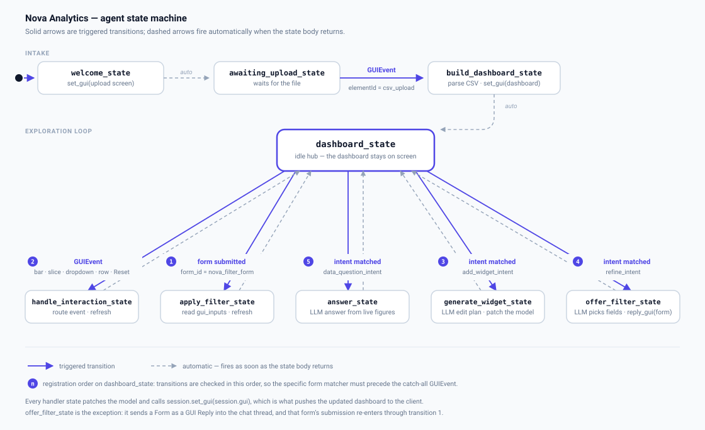

# Nova Analytics — GUI Mode + GUI Replies demo

A data-analysis agent that owns its interface. Built for the demo video of the
GUI-agents paper; exercises both interaction paradigms and LLM-assisted generation
in one continuous session.

## The agent at a glance



Nine states. Three of them (`welcome`, `awaiting_upload`, `build_dashboard`) get the
user from an empty screen to a dashboard; the rest form an exploration loop around
`dashboard_state`, which is an idle hub — it does nothing itself, it just waits to be
pushed out of by the next trigger. Every handler state does its work and falls
straight back to the hub.

What makes the loop interesting is that its five outgoing transitions are fed by three
*different* kinds of trigger — a raw `GUIEvent` from the dashboard, a form submission
from a GUI Reply, and a matched intent from the chat — and they are all first-class
state-machine triggers. Their registration order is their priority, which is why the
specific `when_form_submitted(form_id=…)` matcher has to be declared before the
catch-all `when_event(GUIEvent())`.

## Files

| File | What it is |
|---|---|
| `nova_analytics_agent.py` | The agent: states, transitions, event routing. **Run this.** |
| `state_machine.svg` | The diagram above |
| `gui_builder.py` | The two B-UML `GUIModel`s (upload screen, dashboard) + incremental refresh |
| `analytics.py` | CSV loading, filters, aggregation — plain pandas, no GUI concerns |
| `generate_data.py` | Regenerates `nova_sales_2026.csv` (seeded, deterministic) |
| `nova_sales_2026.csv` | 900 synthetic B2B sales orders across 2026 |
| `smoke_test.py` | Offline check: builds + serializes both models and applies a drill-down |
| `test_edit_ops.py` | Offline check of the model-editing ops (add / replace / remove / rebind), no LLM |
| `config.yaml.example` | Agent properties — copy to `config.yaml` and add your key |

## Running it

```bash
# from the repo root
python baf/test/examples/gui_dashboard_demo/nova_analytics_agent.py
```

The agent listens on `ws://localhost:8777`. In the BESSER agent client
(`http://localhost:5173`): **Add Agent** → name `Nova Analytics`, URL
`ws://localhost:8777`, mode **Full GUI** → open it.

`smoke_test.py` verifies the GUI models, and `test_edit_ops.py` drives the
add/replace/remove/retitle operations against a live model and asserts the numbers
match the dataframe — both without a server or an LLM call.

### Configuration

```bash
cp config.yaml.example config.yaml   # then add your OpenAI API key
```

The demo uses `gpt-4o-mini` for three things: answering questions about the data,
choosing which columns a filter form should offer, and planning dashboard edits.
Everything else — the dashboard itself, the aggregates, the event routing — runs
without an LLM, so `smoke_test.py` and `test_edit_ops.py` need no key.

## The three phases, in demo order

### Phase 1 — GUI Mode, and a GUI the agent builds from your data

The agent calls `session.set_gui()` in its very first state body, so the user lands on
a full-page upload screen rather than an empty chat. The file field carries
`custom_attributes={'data-send-content': 'text'}`, which makes the browser ship the
file body inside the `GUIEvent` — so the agent parses the CSV, computes the figures,
and calls `set_gui()` a second time with a dashboard shaped around that data.

### Phase 2 — the dashboard drives the agent

Every interactive element has a `component_id` (collected in `gui_builder.IDS`), and
that id is what comes back in the `GUIEvent`. `handle_interaction_body` routes it:

| Interaction | What the agent does |
|---|---|
| Click a bar in **Revenue by region** | Drill into that region (click again to zoom out) |
| Click a slice in **Revenue by category** | Add/remove a category filter |
| Change **Region** / **Channel** | Same filters, via the dropdowns |
| Click a row in **Top performers** | Report that rep's numbers in the chat |
| **Reset filters** | Clear the scope |
| **Restore layout** | Rebuild the authored dashboard, discarding every LLM edit |

Each one recomputes and calls `refresh_dashboard()`, which rewrites only
`custom_attributes` on components the model already has (`update_component_by_id`) —
the object graph is never rebuilt. Breakdown charts deliberately keep their full
dimension and dim the unselected bars, so the user can always click across.

The chat panel is an `AgentComponent` inside the same GUI model, so questions about
the data are answered against the *currently scoped* figures.

### Phase 3 — GUI Replies, inside GUI Mode

Ask for filters and the agent sends a `Form` as a **GUI Reply** via
`websocket_platform.reply_gui()`. It renders inside the chat thread, next to the
running dashboard — both paradigms on screen at once. Submitting it fires
`when_form_submitted(form_id=...)`, and the framework has already persisted the field
values in `session.gui_inputs`.

**The form is built around what you asked for.** `choose_filter_fields()` asks the LLM
which columns the request implies, and `build_filter_form()` picks a widget per column
from `analytics.FILTERABLE`:

| Ask | Form you get |
|---|---|
| "filter by date" | a `DateRange` picker, with the dataset's span as help text |
| "only big deals" | a `Slider` for minimum revenue, bounded by the real maximum |
| "break it down by rep" | a `Dropdown` of the actual reps |
| "narrow it down" (generic) | region + channel + category |

`apply_filter_body` reads back whatever fields the form happened to contain and calls
`Filters.set_field()`, which routes each one by kind. Neither the form nor the filter
state is hard-coded to a fixed set of columns.

### Phase 4 — LLM-assisted editing of the live GUI model

Not just "add a card": **add, replace, remove, retitle**. The LLM does not emit the
component — it emits an *edit plan* over the model the agent already owns, and the
agent executes that plan against the typed object graph:

```json
{"operations": [{"op": "replace_chart", "target": "chart_category",
                 "chart_type": "BarChart"}]}
```

| Say | What happens |
|---|---|
| "turn the category pie chart into a bar chart" | `replace_chart` — a chart's class can't be mutated, so the agent builds the replacement and swaps it into the same card |
| "add a chart of revenue by rep, and one by channel" | two `add_chart` ops, aggregated from the dataframe |
| "remove the monthly revenue chart" | `remove` — including the now-empty card wrapper |
| "call it monthly run rate" | `retitle` |
| "add a KPI for average deal size" | `add_kpi` bound to a real metric |
| "a metric card with the november revenue" | `add_kpi` with a `month`, still a real aggregate |

The prompt is given an inventory of the live model (`_inventory()` walks it for
component ids, types and titles), which is what lets the plan target
`chart_category` by name. Operations that name something that doesn't exist are
rejected rather than applied.

**Generated components show real numbers, and keep doing so.** Each one records its
binding in its own `custom_attributes` — `data-bind-dimension` for a chart,
`data-bind-metric` for a KPI — and `refresh_generated()` walks the model on every
refresh, reads those declarations back off the objects, and recomputes from the
dataframe. No registry, and no invented values: drill into a region and a chart the
LLM added two turns ago rescopes along with the authored ones. A month-scoped card
("November revenue") carries `data-bind-month` too, so it narrows to that month
*within* the current scope.

**Restore layout** (next to Reset filters) rebuilds the authored dashboard from
scratch, which is the escape hatch when an improvised edit goes somewhere odd —
handy when demoing live.

`create_gui_with_llm()` keeps the `freeform` op, for a component the plan vocabulary
can't describe. There, structure is all that's being asked for and there's nothing to
bind, which is exactly the case it's good at.

## Suggested video run-through (~5 min)

1. Show `nova_analytics_agent.py` — the state machine, ~340 lines.
2. Open the agent in Full GUI mode: the upload screen *is* the agent's first reply.
3. Drop `nova_sales_2026.csv`. Dashboard appears, built from the file.
4. Click the **EMEA** bar. Narrate: this is a `GUIEvent` hitting a state transition —
   note every KPI, both charts, the leaderboard and the scope label updating together.
5. Click a pie slice to stack a second filter. Show the compound scope label.
6. Ask in chat: *"Which region is underperforming and by how much?"* — grounded answer.
7. Ask: *"turn the category pie chart into a bar chart"* — the chart is replaced in
   place, same card, same data. Narrate: a class can't be mutated, so the agent built
   the replacement and swapped it into the object graph.
8. Ask: *"add a chart of revenue by channel"* — a new chart appears with real
   aggregates. Then drill into a region and show it rescoping with everything else.
9. Ask: *"remove the monthly revenue chart"* — gone, wrapper and all.
10. Ask: *"i want to filter by date"* — a **GUI Reply** form appears in the thread
    beside the dashboard, and it contains a *date range picker*, because the agent
    chose the fields from the request. Set a Q4 range, Apply; the whole dashboard,
    generated charts included, rescopes.

## Framework changes this demo required

Found while building it; all small and generally useful.

**`baf` (this repo)**
- `websocket_platform.py`: the GUI pushed on connect now uses `AGENT_REPLY_GUI_UPDATE`
  instead of `AGENT_REPLY_GUI`. Without this, a session GUI and a GUI Reply are
  indistinguishable on the wire, and a GUI Reply would blow away the full-page panel.
- `agent_gui.py`: **new `AgentGUI.remove_component(component_id)`**. `AgentGUI` could
  find, update and add, but not delete — so an agent could grow a GUI and never prune
  it, and could not replace a component with one of a different type. Removal plus
  `add_component` is what makes "turn this pie chart into a bar chart" expressible.

**`BESSER-Agentic-Framework-UI`**
- `GUIAgentLayout.tsx`: only `AGENT_REPLY_GUI_UPDATE` replaces the full-page GUI;
  `AGENT_REPLY_GUI` is routed to the embedded chat. This is what lets both paradigms
  coexist. Also keeps the agent-assigned `message_id` so `form_id` matching works.
- `GUIRenderer.tsx`:
  - `Table` and `MetricCard` rendered placeholders (`(data rows)`, `—`). They now read
    real values from `custom_attributes` (`data-rows`, `data-value`, `data-delta`,
    `data-caption`), with optional pagination and row-click events.
  - Charts never re-rendered when their data changed — the effect keyed only on name
    and type. The series payload is now part of the effect's identity.
  - Charts emitted no events. `plotly_click` now produces a `GUIEvent` carrying the
    clicked category, series and value.
  - Bar and pie charts accept a per-point `color`, so an agent can highlight the
    selected slice.
  - A `File` field with `data-send-content: text|base64` now sends the file's contents,
    not just its name.
  - A `Dropdown` remounts when the agent changes its `default_value`, so an
    agent-driven selection is actually visible.
  - A `Screen`'s own styling was ignored; in full-GUI mode it now drives the page
    (background, padding, top-level layout).
  - A `DateRange` field rendered two *unnamed* date inputs, so `FormData` skipped it
    and submitting a form silently dropped the range. It now carries a named hidden
    JSON field.
  - `Styling.position.p_type` was discarded instead of mapped to CSS `position`, so a
    full-page GUI could not have a sticky panel.
- `App.css`: full-GUI content area no longer imposes its own padding, and a full-page
  screen stretches to the viewport. An embedded chat widget's message list had a hard
  `max-height: 420px` that left it short inside a full-height panel; it now flexes,
  and its input row drops the app-level 10% side padding that cramped a docked panel.

## Naming: paper vs. code

The paper names some APIs that do not exist under those names. Worth aligning before
submission:

| Paper | Actual API |
|---|---|
| `session.reply_gui(...)` | `websocket_platform.reply_gui(session, gui)` |
| `update_attribute(id, attr, value)` | `AgentGUI.update_component_by_id(id, **kwargs)` |
| `insert_element(parent_id, component)` | `AgentGUI.add_component(component, parent_id=...)` |
| `find_component(id)` | `AgentGUI.find_component(field, value)` — e.g. `('component_id', id)` |
| `Chart`, `Dropdown`, `DatePicker` components | `BarChart`/`PieChart`/`LineChart`; `InputField(field_type=InputFieldType.Dropdown / .Date)` |

`session.set_gui()`, `create_gui_with_llm()` and `when_form_submitted()` match the
paper exactly.
