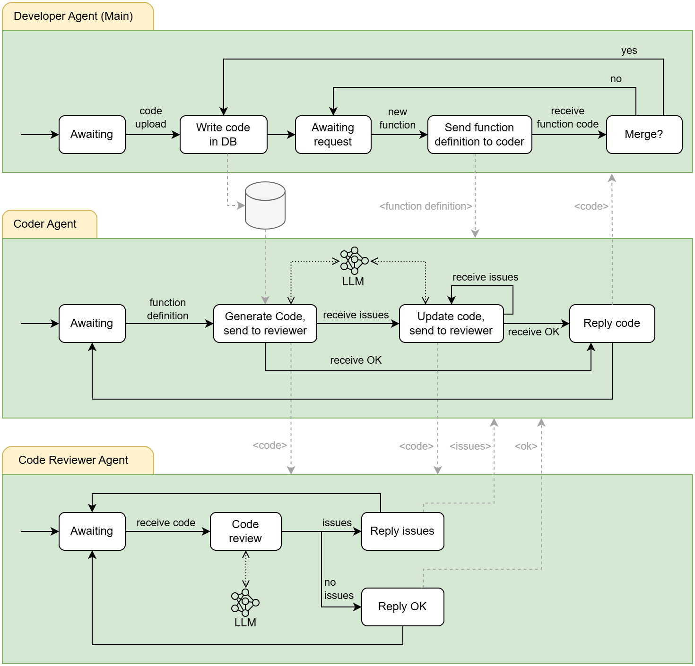

Your first multi-agent
======================

An agent on its own can be smart, but things get really interesting when multiple agents team up.

BAF allows building **multi-agent systems** where each agent has a specific role, shares information, and works together to get the job done more efficiently.

In this section, we will walk through a **running example** to see how agents interact in action. The system we are looking at is designed to help developers write source code.

.. note::

   This tutorial may be too advanced for BAF beginners. We recommend you understanding the core ideas of agents (:doc:`../wiki` section) before diving
   into this example.

This system is composed by 3 agents:

- **Main Agent**: The agent that interacts with the developer, collecting his/her requests. It will store a piece of
  code and will ask for code modifications to a coder agent (in this example, we only considered adding new functions).
- **Coder Agent**: This agent receives coding requests (sent by the main agent) and leverages a specialized LLM to generate
  the requested code. Before replying back the generated code, it is sent to a reviewer agent to check for possible
  errors or bugs. If something was found, the coder agent iterates again to fix the received issues.
- **Code Reviewer Agent**: This agent receives a piece of code and is in charge of finding errors or bugs, leveraging a specialized LLM.

   Multi-Agent System

.. note::

   To enable the communication between agents, they must know their WebSocket URLs, which they will use to send/receive messages.

   Learn how to send messages between agents here: :any:`communication-between-agents`

Running the example
-------------------

The three agents are **separate long-running Python processes**. Running ``main_agent.py``
does not start the coder or reviewer. Start all three before sending a request to the main agent.

Use a clone of this repository and install it in the Python environment shared by the three
terminals. From the repository root:

.. code:: bash

    python -m pip install -e ".[torch,extras,llms]"

Configure ``baf/test/examples/config.yaml`` with your ``nlp.openai.api_key`` for the coder
and reviewer. If you are not using the optional databases, set ``db.monitoring.enabled``
and ``db.streamlit.enabled`` to ``False`` instead of leaving the example database placeholders
enabled. See :doc:`wiki/configuration_properties` for the available settings.

In **each** terminal, activate the same Python environment and change to
``baf/test/examples/multiagent`` inside your clone. This working directory matters: all three
scripts load ``../config.yaml`` relative to it. Then run one command per terminal, in this order:

.. code:: bash

    # Terminal 1: reviewer (keep running)
    python reviewer_agent.py

.. code:: bash

    # Terminal 2: coder (keep running)
    python coder_agent.py

.. code:: bash

    # Terminal 3: main agent (keep running)
    python main_agent.py

Wait for each agent to finish initialization and start its WebSocket server. With the bundled
configuration, the main agent listens on ``ws://localhost:8765``, the coder on
``ws://localhost:8011`` and the reviewer on ``ws://localhost:8012``. The main agent starts the
chat UI; the other two use ``use_ui=False``. Open the main agent's UI at the address printed
in its terminal (``http://localhost:5000`` with the bundled configuration), upload a code file,
and then request a modification. Leave all three terminals running throughout the conversation.

If a peer connection is refused, check that the coder and reviewer are still running and that
their ports match the URLs in ``send_message_to_websocket()``. A port already in use must be
freed, or changed consistently in both the server settings and the calling agent's URL.
Stop each process with ``Ctrl+C`` when finished.

**Example Workflow:**

1. A developer imports the code of an application into the database.
2. The developer asks the system to generate a function for processing user authentication.
3. The **Main Agent** assigns the request to the **Coder Agent** to generate the function.
4. The **Coder Agent** produces the code.
5. The **Coder Agent** sends the request to the **Reviewer Agent**
6. The **Reviewer Agent** analyzes the code for possible bugs or syntax errors.
7. The **Reviewer Agent** finds a bug and sends it back to the **Coder Agent**.
8. The **Coder Agent** updates the code fixing the received issue.
9. The **Coder Agent** sends the request to the **Reviewer Agent**
10. The **Reviewer Agent** does not find any issue and replies OK.
11. The **Coder Agent** receives the OK and replies the new code to the **Main Agent**.
12. The **Main Agent** updates the code database and awaits for a new developer query.

The following sections show the code implementation for each agent.

Developer Main Agent
--------------------

.. literalinclude:: ../../baf/test/examples/multiagent/main_agent.py
   :language: python
   :linenos:

Coder Agent
-----------

.. literalinclude:: ../../baf/test/examples/multiagent/coder_agent.py
   :language: python
   :linenos:

Code Reviewer Agent
-------------------

.. literalinclude:: ../../baf/test/examples/multiagent/reviewer_agent.py
   :language: python
   :linenos:
